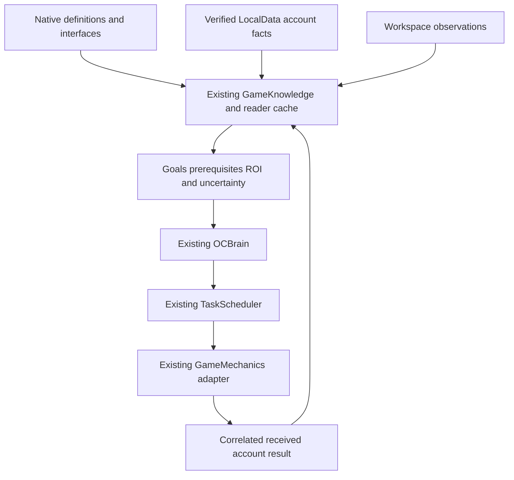

# System dependencies and transport

Research only,2026-10-11. Static require references are evidence of saved source dependencies, not proof that every module successfully loads or that its downstream runtime behavior is valid.

## Complete source-metadata dependency index

`inventory/DEPENDENCY_REFERENCES.jsonl` records4,116 require expressions from626 readable scripts with source path and returned line number.3,848 simple static candidates match script paths in the complete inventory;268 expressions remain unresolved (locals, script children, dynamic aliases or parser limitations). Candidate normalization is explicitly a static reference candidate, not execution.75 scripts were unavailable to the dot-path source reader; their dependencies remain unavailable. Regex extraction can miss multiline/dynamic require patterns. Use the source ledgers for deep-reviewed behavior; a dependency entry alone is not a contract.

Each `source_metadata_*.jsonl` also records named function declarations/signatures and named method-call labels where extractable. A named method call is not automatically a network request: receiver identity and facade definitions must be checked. `MODULE_INDEX.md` retains name-based purpose/phase triage separately from these source-confirmed metadata expressions.

## Native knowledge chains

| System | Definition inputs | Effective calculation / received state | Native interaction / physical layer |
|---|---|---|---|
| Team/economy | Pets,Enchants,Currency,Mastery,Buffs,Constants | PetInventory → PetUtil/EnchantUtil/StatsUtil plus Teams,actual owned records,passes,MasteryUpgrades,buffs,milestones/daily perks | Inventory/Teams/Enchants/Hatch client; Workspace egg identity and ranges |
| Progression | Worlds,WorldMap/area definitions,Physics,egg catalogs | received AreasUnlocked/WorldsUnlocked; ProgressionGraph future consumers | WorldMap,Physics trampoline hooks,ClientScript portal bindings; actual target spawn and destination observations |
| Mastery | Mastery Types/Upgrades | MasteryUtil plus received MasteryLevels/MasteryUpgrades | Mastery GUI; Outer Space HUD gate; physical station proximity not established by GUI alone |
| Vendors | Shops,ShopBuilder,ShopItemBuilder | ShopUtil + Period/Bought/free-rerolls + received mastery ShopSlots,milestone,ShopDay | ItemShop → named network requests; tagged physical models + ShopId attribute remain separate |
| Quests | QuestBuilder/TaskBuilder,GenieQuest,SeasonChallenges | QuestUtil + actual Quests/Progress/QuestsCompleted; SeasonUtil filters + actual Seed/Next | Quests/GemGenie/Season/ChallengePass clients; no invented generic ClaimQuest |
| Claims | Playtime,DailyRewards,Chests,WorldRewards,Index/Milestones catalogs | native eligibility helpers plus received claimed maps,progress and server-time deadlines | principal GUI callbacks and PhysicalItem/Chest; rendering/presentation is not account result |
| Rifts/events | Rifts,RiftSummonCosts,Events,XL/SecretBounty/Halloween definitions | RiftSummonUtil,Bounty/SecretBountyUtil,Upgrades/RebirthUtil + actual prerequisites | ClientScript prompts,RiftSummon/Halloween frames + live rift/house/spawn attributes |
| Fishing/minigames | Fish/Areas/Rods/Baits/Enchant catalogs,Minigames/Obbys | FishingUtil/difficulty/prize helpers + actual account,quest,timer and FSM state | Rod state machine,Board/minigame handlers,physical entrances; incomplete decompiled math remains unknown |

Important cross-links: hatching can advance quests, milestones, Index and bounty while improving teams. Vendor purchases can progress ShopBuy tasks; crafting/using boosts can improve later throughput and milestones, while spending reserves. Fishing consumes rod/bait resources and generates separate Pearl opportunities. Rift eggs/shops have expiry and travel costs. These links are future planner hypotheses until eligibility and actual progress deltas are observed; do not count the same reward multiple times.

## Named network facade

SOURCE_CONFIRMED — `ReplicatedStorage.Shared.Framework.Network.Remote:8–9` uses child `RemoteEvent` and `RemoteFunction` under that ModuleScript. These are observed objects in the full hierarchy. They differ from the six descendant objects under `ReplicatedStorage.Remotes`, which include PlayerData events and Pickups.

Facade FireServer at90–98 forwards the action string and payload to its child RemoteEvent; InvokeServer127–135 forwards to its RemoteFunction. `Event(label).Connect` supplies a per-label client signal (`28–51`), and inbound client dispatch rejects non-string labels (`72–88`). Function registration/dispatch are at117–148. The source contains generic server dispatch scaffolding, but the actual game server action handlers are not supplied: this facade does not establish accepted gameplay argument validation, cooldowns, prices or grants. All gameplay requests remained unsent.

SOURCE_CONFIRMED — `ReplicatedStorage.Remotes.PlayerDataLoaded/PlayerDataChanged/PlayerDataFailed` are read by native LocalData. Pickups have dedicated SpawnPickups/CollectPickup. A label such as UpgradeMastery is not necessarily a separately named remote instance. Future GameMechanics should keep the existing mechanics adapter and verified facade signature; never enumerate labels and call them speculatively.

## OC ownership map

The local architecture audit is in [OC_BRAIN_INTEGRATION_MAP.md](OC_BRAIN_INTEGRATION_MAP.md) and [LOCAL_ARCHITECTURE_EVIDENCE.md](LOCAL_ARCHITECTURE_EVIDENCE.md). Proposed data flow:

HYPOTHESIS for future extension: use the existing dependency cache with semantic invalidation; add well-scoped definitions/observations and policies to the existing Brain. Scheduler owns budgets, activity/location leases, cancellation, deadlines and verification. Mechanics owns supported request/navigation execution after approval. No second scheduler, independent farming loop, speculative remote loop or movement toward individual pickups is proposed. Every future implementation remains subject to phase gates and owner testing.

## Source fidelity and side effects

Shared helpers are not all pure. BuffUtil.UseBuffs can decrement uses/update supplied state; GetPickupZones alters transparency/collision; SeasonUtil.RefreshSeason/RefreshChallenges/UpdateInfinityTrack mutate account tables and require paths may create events or loops. Reading source is safe; requiring/executing modules for research would violate the read-only assignment. Static external arithmetic in documentation is permissible when clearly labelled conditional derivation. No native module was executed.
